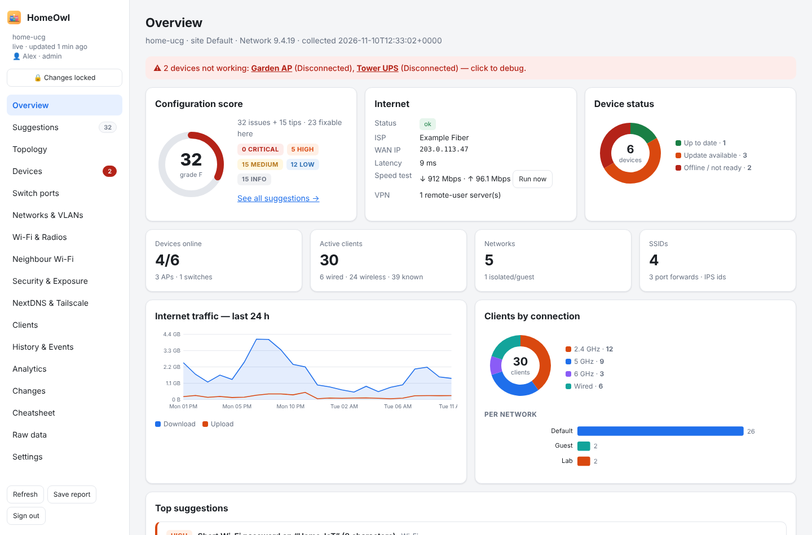
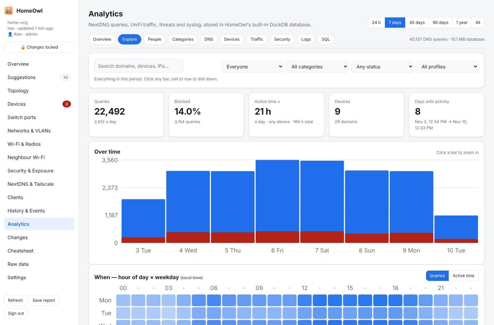

<p align="center"></p>

<h1 align="center">HomeOwl</h1>

<p align="center"><b>A friendly watcher for your home network.</b><br>
Reviews your UniFi setup, fixes problems with one click, shows who uses what and when (NextDNS + UniFi), and lets an AI assistant help — all from one program that runs on your own computer.</p>

<p align="center">
<a href="https://github.com/h4ux/HomeOwl/actions/workflows/ci.yml"></a>
<a href="LICENSE"></a>
</p>

<p align="center"></p>

> HomeOwl is an independent open-source project. It is not affiliated with or endorsed by Ubiquiti, NextDNS or Tailscale.

## What it does

- **Configuration review** — scores your UniFi setup and explains each suggestion (Wi-Fi security, firmware, exposed ports, IoT isolation, DNS, VLANs…), with a one-click fix where it's safe.
- **Devices & clients** — topology, switch ports, Wi-Fi radios and neighbours, a debugger for devices that went offline, and icons for every kind of device.
- **Safe changes** — every change is allow-listed, previewed first, logged with who made it, and can be undone. Changes stay locked until an admin unlocks them.
- **Config history** — a snapshot of your UniFi settings whenever they change, and a plain “what changed since yesterday” (also changes made in UniFi itself).
- **Family analytics** — imports NextDNS query logs, UniFi traffic, sessions, events, threats and the gateway's syslog into a built-in DuckDB database. Drill down by person, device, category, domain, hour of day and weekday, down to individual DNS queries.
- **People & categories** — group devices per family member; domains are sorted into subjects (Social, Video, Gaming, AI…) and you can add your own rules.
- **NextDNS & Tailscale helpers** — per-network NextDNS profiles and device names, plus Tailscale guidance.
- **AI & MCP** — an [MCP](https://modelcontextprotocol.io) server so Claude (or any MCP client) can answer questions about your network and, if you allow it, make guarded changes.
- **Guest Wi-Fi** — the guest network's name and password with a scan-to-join QR code in five styles, a printable card, and a new password in one click (previewed, logged, undoable).
- **Cameras** — for UniFi Protect: the latest picture from each camera (or a Live view refreshing every second or two), whether it is online, and a timeline of people, vehicles, packages, animals, sounds and doorbell rings that you can filter. HomeOwl records these events while it runs and keeps them 30 days. It only reads from Protect. Only admins see cameras unless an admin shares them with viewers. If Protect runs on a different console than Network (for example a UNVR next to a Cloud Gateway), HomeOwl finds it on your network and you connect it on the Cameras page. A camera wall fills the screen with the cameras you pick, and any camera can float in a small always-on-top window.
- **Doors** — for UniFi Access: which doors are locked or open, and who came in over the last 7 days, including refused attempts. Admins can also unlock a door remotely. Remote unlock is off until an admin turns it on, asks for confirmation each time, needs changes to be unlocked, and is logged with who did it. Access uses its own API token, which is kept in the keychain.
- **UPS** — connects to a NUT (Network UPS Tools) server, for example a Raspberry Pi, a Synology or another NAS, and shows each UPS's status, battery, runtime, load and mains voltage, with 7 days of readings and a year of power cuts. Like NUT's `upsmon`, it can register as a secondary and run scripts when the power fails, comes back or the battery runs low. HomeOwl shuts this computer down in time with its suggested script for macOS, Linux or Windows. It only runs scripts from its own scripts folder; the web page can pick a script but can't add commands. On a Mac, **Allow shutdown** gives it permission in one step (macOS asks for your password once).
- **Today** — one screen for the household: what needs attention, who's home, the cameras, the UPS and the network.
- **Who's home** — tag each person's phone and HomeOwl shows who's home and since when, with an optional history of arrivals and departures (kept on this computer only).
- **Menu bar (macOS)** — an owl in the menu bar (five icon styles, optionally with a status dot or a problem count). Click it for internet, network, UPS and who's home, the guest Wi-Fi code, updates and start at login. Turn it off or pick the icon in **Settings › System**.
- **Device check-in** — family members open `http://<HomeOwl>:8555/hi` (or scan its QR code) on their own phone, tablet or laptop and say what it is and whose; HomeOwl finds the device by its address, and an admin's approval sets its UniFi name and gives it to that person.
- **Accounts** — admin and view-only users with passwords; optional sign-in through Tailscale.

<p align="center"></p>

## Install

**macOS and Linux**

```sh
curl -fsSL https://github.com/h4ux/HomeOwl/releases/latest/download/install.sh | sh
```

**Windows** (PowerShell as Administrator)

```powershell
irm https://github.com/h4ux/HomeOwl/releases/latest/download/install.ps1 | iex
```

The installer downloads the right build for your system, checks its checksum, installs `homeowl` and sets it up as a background service (LaunchAgent on macOS, systemd on Linux, a Windows service on Windows). Then open **http://127.0.0.1:8555** on that computer and create your admin account. If you run the program by hand instead, **Settings › System › Start with this computer** turns the background service on or off (on Linux and Windows it shows the admin command to run).

Prefer to do it by hand? Download a release archive, unpack it and run `./homeowl` — or build from source (below).

### Updating

HomeOwl checks GitHub for new releases twice a day (turn it off in **Settings › System**) and shows **Update available** in the sidebar, next to the version you run. Click it to see what's new and either update in one click (when HomeOwl may replace its own program file, e.g. the Windows service) or copy the command — `sudo homeowl update`, or the install command above. A running HomeOwl notices its new program file and restarts by itself; downloads are checked against the release's SHA256 checksums.

### First steps

1. **Create the admin account** on the computer running HomeOwl (from another device you'll need the one-time code shown by `homeowl setup-code`).
2. **Settings › Connection** — enter your console's IP and an API key (UniFi Network › Settings › Control Plane › Integrations).
3. **Settings › Access** — choose how people reach HomeOwl:
   - **Home network**: `https://<computer-ip>:8555`, username + password (HomeOwl makes its own certificate; your browser warns once).
   - **Built-in Tailscale**: HomeOwl joins your tailnet as its own device with a real HTTPS address (`https://homeowl.<tailnet>.ts.net`). Tailnet logins linked to a user sign in automatically.
4. **Settings › Analytics** — add your NextDNS API key(s) and point the gateway's syslog at HomeOwl.
5. **Settings › Users** — add family members as admins or view-only users.

## Using it with Claude (MCP)

Turn on **Settings › AI & MCP**, pick a mode and create a token:

| Mode | What an AI client can do |
|---|---|
| Read only | Look up devices, clients, Wi-Fi, firewall, events and usage analytics |
| Read + guarded changes | Also allow-listed changes (block a client, restart a device, toggle Wi-Fi…) — always previewed, logged and undoable |
| Full access ("god mode") | Also raw requests to any UniFi API endpoint — no preview, no undo |

Claude Code:

```sh
claude mcp add --transport http homeowl https://homeowl.<tailnet>.ts.net/mcp --header "Authorization: Bearer <token>"
```

Claude Desktop (`claude_desktop_config.json`):

```json
{ "mcpServers": { "homeowl": { "command": "/usr/local/bin/homeowl", "args": ["mcp", "--token", "<token>"] } } }
```

See [docs/mcp.md](docs/mcp.md) for the full tool list.

## Command line

```text
homeowl                      run in the foreground (opens your browser)
homeowl service install      run in the background (then: start | stop | restart | status | uninstall)
homeowl mcp --token …        connect an MCP client over stdio
homeowl reset-password USER  set a new random password
homeowl setup-code           show the one-time code for the first admin
homeowl update [--check]     install the latest release (checksum-verified)
homeowl version
```

Data lives in your user's app folder (`~/Library/Application Support/HomeOwl`, `~/.config/homeowl`, `%APPDATA%\HomeOwl`, or `%ProgramData%\HomeOwl` for the Windows service). Use `--data DIR` or `HOMEOWL_DATA` to change it.

## Security

- API keys are stored in the system keychain (macOS Keychain, Windows Credential Manager, Linux Secret Service) or, where none exists, a file only your user can read. They are never sent to the browser or to AI clients.
- Passwords are hashed with PBKDF2-SHA256 (600,000 rounds); sessions use HttpOnly, SameSite=Strict cookies plus a per-session token on every change; failed logins are rate-limited.
- HomeOwl checks the `Host` header (blocks DNS rebinding), rejects cross-site requests and sends strict security headers.
- The analytics SQL console is read-only and DuckDB runs without file or network access.

Found a problem? Please report it privately — see [SECURITY.md](SECURITY.md).

## Build from source

Requirements: Go 1.24+ and a C compiler (DuckDB is linked in via cgo).

```sh
git clone https://github.com/h4ux/HomeOwl && cd HomeOwl
make build-lite      # without built-in Tailscale
make tidy build      # full build (fetches tailscale.com once)
./homeowl run --data ./.devdata
```

The web UI is plain HTML/CSS/JavaScript in `web/static` (no build step) and is embedded into the binary.

## Roadmap

Bedtime & homework modes, network health, guest Wi-Fi vouchers, a phone app and "Ask HomeOwl" — see [ROADMAP.md](ROADMAP.md).

## Contributing

Contributions are welcome — please read [CONTRIBUTING.md](CONTRIBUTING.md) and our [Code of Conduct](CODE_OF_CONDUCT.md).

## License

[MIT](LICENSE). UniFi is a trademark of Ubiquiti Inc.; NextDNS and Tailscale are trademarks of their owners.
