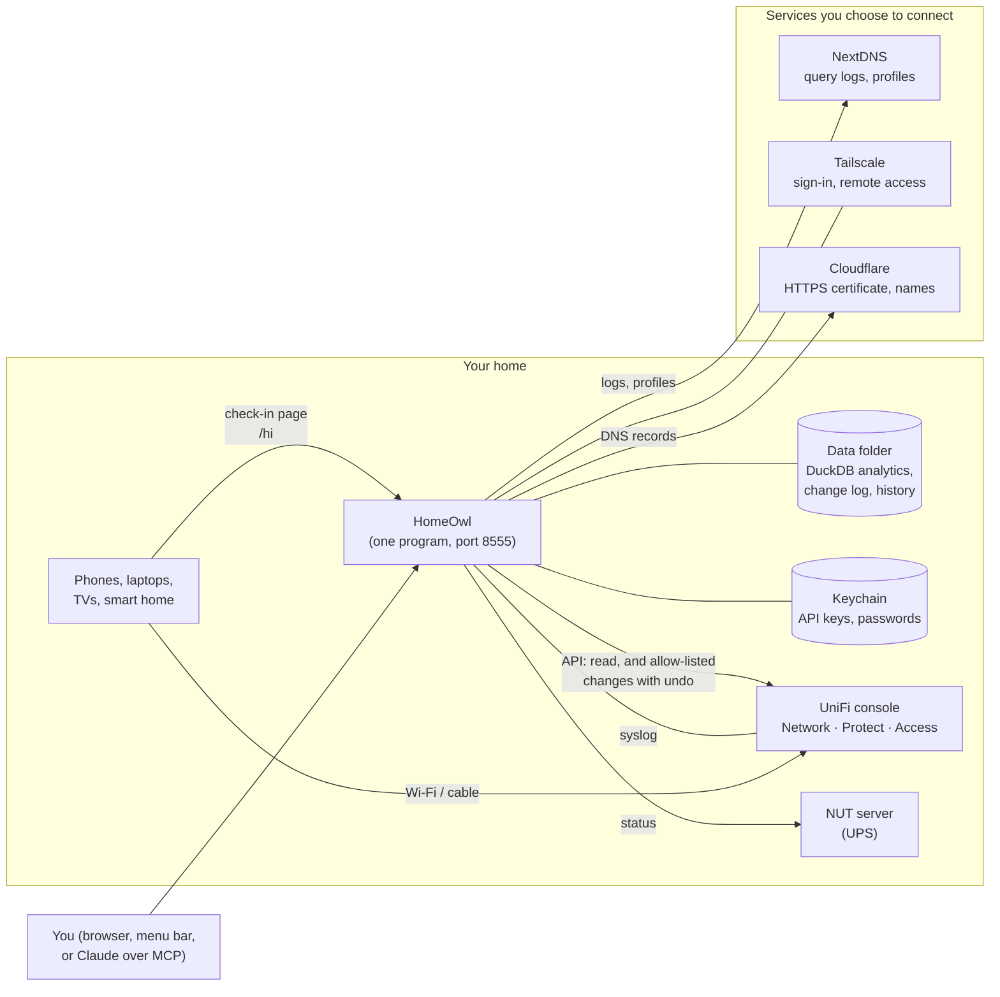
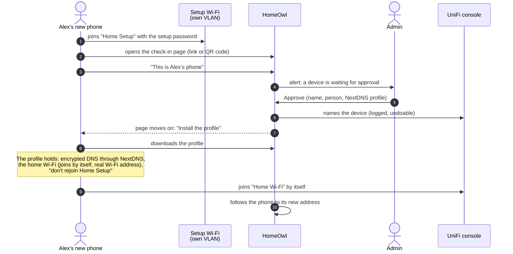
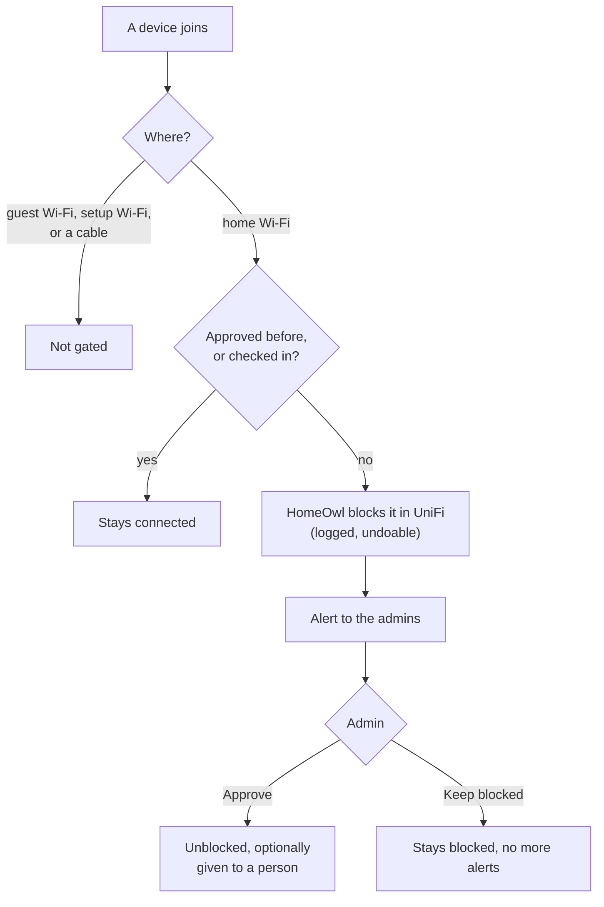
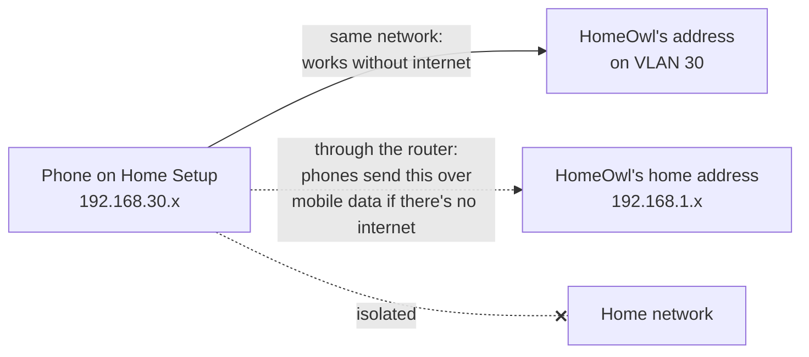

# How HomeOwl works

HomeOwl is one program that runs on a computer in your home (a Mac, a Linux box or a Windows PC). It talks to your
UniFi console and, if you connect them, to NextDNS, Tailscale and Cloudflare. Everything it learns stays on that
computer: settings and history in its data folder, secrets in the system keychain.

All names and addresses on this page are examples (`Home Wi-Fi`, `Home Setup`, `192.168.1.x`, "Alex").

## The pieces

- **Reads** come from the UniFi console's API and NextDNS's API, and are stored in an embedded DuckDB database for the
  Explore and analytics pages.
- **Changes** to the console go through one allow-list. Each one is previewed first, logged with who made it, and can
  be undone from the Changes page. Changes stay locked until an admin unlocks them.
- **Secrets** (API keys, Wi-Fi and VPN passwords) live in the keychain. They are never sent to the browser, to MCP
  clients or to the logs.

## Getting a new device onto the home Wi-Fi

The home Wi-Fi password stays with the admins. New devices come in through a separate **setup Wi-Fi** and get the
home Wi-Fi from a configuration profile.

- **Profile types** decide what goes in the profile: which Wi-Fi networks it joins, a VPN, a Home Screen icon. One
  type can be the default for everyone. "Don't join our other Wi-Fi networks" lists open networks as don't-join and
  leaves password networks out, so a device can't join them without someone typing the password.
- **Android and Windows** can't install these profiles: their page shows the NextDNS setting and the home Wi-Fi's
  name and password instead.
- **NextDNS on the move:** the profile's encrypted DNS stays on at home, on mobile data and on other Wi-Fi. It stands
  down on networks in a list (planes and hotels whose sign-in page needs ordinary DNS).

## Approving new devices

With **Approve new devices** on, HomeOwl checks the network every minute.

Turning it on approves the devices seen in the last day, so nothing in use is cut off. Devices not seen for longer
wait for approval when they come back. More than ten new devices at once pauses blocking and alerts instead.

**A grace period** (Settings › Device profiles › Approve new devices) keeps a new device online for a while —
15 minutes to 7 days — so there's time to decide; it's blocked only if nobody approves it by then. With an ntfy
topic in Settings › Alerts (Generate makes a private one), each new device is pushed to your phone with **Approve**
and **Block** buttons. A tap doesn't call HomeOwl: it posts a signed, one-time answer to a second private ntfy topic
that HomeOwl listens to, so it works from anywhere without opening HomeOwl to the internet. Answers expire after two
days, and HomeOwl only acts on its own.

**If HomeOwl is down, or blocked a device by mistake:** the block lives in UniFi, so lift it there. In the UniFi
app (or unifi.ui.com), open Client Devices, show the Blocked ones, open the device and tap Unblock. When HomeOwl runs
again it sees the device connected and counts it as approved. A stopped HomeOwl blocks nothing new. Settings › Device
profiles has these steps too, with a page to print and keep by the router.

## The device's own page (and asking for a blocked site)

Once a device is approved, its check-in page (the **HomeOwl** icon its setup profile puts on the Home Screen) becomes
that device's own page. There's no sign-in: HomeOwl recognises the device by its address on the home network, so the
page shows that device and nothing about anyone else's:

- **Is it OK?** Protected and in use, an update to install, or the setup stopped (with the steps to fix it).
- **Right now.** The Wi-Fi and access point it's on, the signal (with a tip when it's weak), and whether the internet
  works, with the console's last speed test.
- **Blocked on this device.** What NextDNS blocked under the device's name in the last day, and why. **Ask to allow**
  (with an optional reason), or type another site. At most five requests wait per device.
- **Guest Wi-Fi.** The guest network's name, password and join code, so a visitor can scan it off the family member's
  phone (the setup Wi-Fi is never shown). This works whether or not the guest card at `wifi.local` is turned on.

"Is it OK?" matches NextDNS logs by every name the device has had (on letters and digits only, so a curly
apostrophe or dashes for spaces still match): its name now, the name in the profile it installed
(the profile keeps reporting that one after a rename), and the names of check-ins merged into it. A device marked
stopped that NextDNS has seen since no longer shows as stopped.

A request shows up on **Home › Today** and in **Home › Alerts** with **Allow** and **Deny**, and on
**Devices › New devices** under *Site requests*. With ntfy set up, the push has Allow and Deny buttons that work the
same way as the new-device ones (a signed one-time token posted to the private reply topic). Allowing puts the site
on the **allowlist of the device's NextDNS profile**, so it's allowed for everyone using that profile, and it's
logged in **History › Changes**. *Stop allowing* takes it off again. The device's page shows each answer.

## The setup Wi-Fi's network

HomeOwl can create the setup Wi-Fi for you (Settings › Device profiles): a network on its own VLAN and a Wi-Fi on it
with its own password, modelled on your home network and Wi-Fi. Settings then shows three things about it:

1. **Internet:** a phone on a Wi-Fi without internet soon sends everything outside that network over mobile data, so
   a check-in page on the home network stops loading. Either the setup Wi-Fi has internet, or
2. **HomeOwl has its own address on it** (its computer joins the VLAN over the same cable). Then the page loads
   directly, and the setup Wi-Fi can do without internet. Anyone who knows the setup password can use its internet,
   so turn it off once HomeOwl is on the VLAN.
3. **Isolation** keeps devices on the setup Wi-Fi away from the home network.

## Keeping the lists tidy

Phones and laptops use a private Wi-Fi address per network, and change it now and then. UniFi keeps every address it
has seen, so one phone can show up several times. **Devices › All devices** suggests archiving older copies of a device
that is now on a newer address, and private addresses unused for 90 days. Archived addresses leave HomeOwl's lists;
UniFi, the logs and the history keep them, and they can be restored. A device that comes back online shows again.

## Where things live

| What | Where |
| --- | --- |
| Settings, people, check-ins, change log | the data folder (a per-user app folder, or `--data` / `$HOMEOWL_DATA`) |
| Analytics (DNS queries, traffic, sessions) | DuckDB in the data folder, read-only SQL console |
| API keys, Wi-Fi and VPN passwords | the system keychain (or `<data>/secrets` without one) |
| The web app | built into the program: plain HTML, CSS and JavaScript, no build step |
| AI access | the MCP server, with its own mode: off, read, guarded or god (raw API, logged) — see [mcp.md](mcp.md) |
